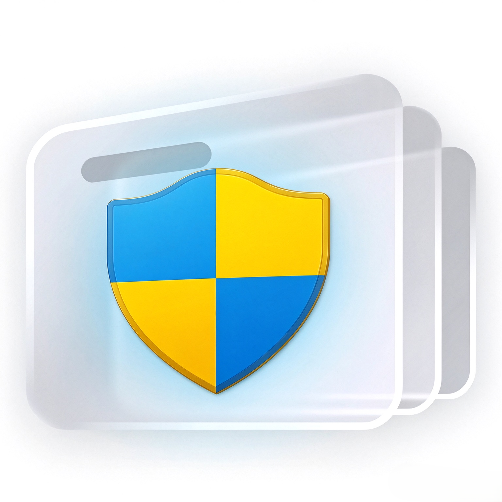

<div align="center">


<h1>以管理员身份自启动 — Class Widgets 2</h1>

<p>通过 <b>Windows 计划任务</b>，让 Class Widgets 2 在你登录 Windows 时<b>以管理员身份自启动</b>。</p>

[](https://github.com/Kryon2025/com.classwidgets.startupasadmin/releases)
[](https://github.com/Kryon2025/com.classwidgets.startupasadmin)
[](https://github.com/Kryon2025/com.classwidgets.startupasadmin/blob/main/LICENSE)
[](https://github.com/Kryon2025/com.classwidgets.startupasadmin/releases)

</div>

> [!NOTE]
> 当前版本 **1.0.1**，要求 Class Widgets 2 的插件 API `~=0.6.0`。
> 在 [插件广场](https://plaza.cw.rinlit.cn/plugins/com.classwidgets.startupasadmin) 可以一键安装/更新，也可以在 Release 页下载 `.cwplugin` 手动导入。

插件本身不含桌面组件，只在设置里增加一个「以管理员身份自启动」页面。

## ✨ 功能

- 一键创建 / 更新计划任务（登录时以最高权限启动 Class Widgets 2）
- 一键删除计划任务
- 自动探测主程序路径，探测失败可手动指定
- 显示任务状态：是否已创建、运行级别、已注册的路径
- 程序位置变化后能识别出"需要更新"
- 提权操作在后台线程执行，等待 UAC 时界面不会卡住

## 📦 安装

1. 将插件目录放入 Class Widgets 2 的 `plugins/` 目录
2. 重启 Class Widgets 2
3. 打开 **设置 → 以管理员身份自启动**

## 🚀 使用方法

1. 进入设置页，确认「主程序」路径显示正确
   *（如果显示"未找到"，展开「高级 → 主程序路径」手动填入 Class Widgets 2 的 exe）*
2. 点击 **创建 / 更新计划任务**
3. 在弹出的 **UAC 授权窗口**里选择"是"
4. 状态变为绿色「已就绪」即完成

之后每次登录 Windows，Class Widgets 2 都会以管理员身份自动启动，不再出现 UAC 提示——因为计划任务本身已经带了最高权限。

## ⚠️ 注意事项

- **需要管理员授权**：创建 / 删除计划任务都必须提权，会弹出 UAC。取消授权会显示"已取消管理员授权（UAC）"，不会产生任何改动。
- **任务不随插件卸载而删除**。这是刻意设计——避免卸载插件时意外丢掉自启动配置。不需要时请回到设置页手动删除。
- **移动程序后需要更新**：如果你把 Class Widgets 2 换到了别的目录，任务里记录的仍是旧路径，需要重新点一次「创建 / 更新计划任务」。设置页会用黄色提示这种情况。
- **登录自启动 ≠ 立即启动**：任务只在登录时触发一次。想让当前这次也以管理员身份运行，请手动退出后以管理员身份重新打开程序。

## 🧠 工作原理

```
设置页点「创建 / 更新」
        │
        ▼
后台线程写出临时 PowerShell 脚本
        │
        ▼  ShellExecuteExW(verb="runas")   ← UAC 授权窗口
提权后的 PowerShell：
    New-ScheduledTaskAction      -Execute <Class Widgets 2.exe>
    New-ScheduledTaskTrigger     -AtLogOn
    New-ScheduledTaskPrincipal   -RunLevel Highest      ← 以管理员身份
    Register-ScheduledTask -Force
        │
        ▼  结果写入临时文件（提权进程无法回传 stdout）
后台线程读回结果 → 发 statusChanged → 设置页刷新
```

任务状态用 `Get-ScheduledTask` 查询，**不需要提权**。

主程序路径的探测顺序：`sys.executable`（打包运行时即主程序）→ 插件目录向上找到主程序根目录 → 按已知文件名匹配 → 兜底扫描根目录下的 exe。

## 🩺 常见问题

| 现象 | 原因 / 处理 |
|---|---|
| 显示"未找到主程序" | 自动探测失败，展开「高级」手动填入 exe 绝对路径 |
| 点创建后没有反应 | UAC 窗口可能弹在了别的显示器/被最小化，后端仍在等待。取消后会有"已取消"提示 |
| 登录后没有自启动 | 打开 Windows「任务计划程序」，找到本任务，查看"上次运行结果"；常见原因是程序被移动过 |
| 状态显示"指向的程序已变化" | 程序换过位置，重新点一次「创建 / 更新」即可 |
| 想彻底移除 | 设置页点「删除计划任务」（同样需要 UAC） |

## 📁 文件说明

```
├── cwplugin.json            # 插件清单
├── main.py                  # 插件入口：注册设置页、后台线程执行提权操作
├── startupasadmin_config.py # 配置模型（任务名 / 自定义主程序路径）
├── startupasadmin_tasks.py  # 计划任务创建、删除、查询 + UAC 提权
├── qml/settings.qml         # 设置页
├── icon.png
└── README.md
```

本地模块都带插件前缀命名（`startupasadmin_*`），避免与其它插件的同名模块冲突。